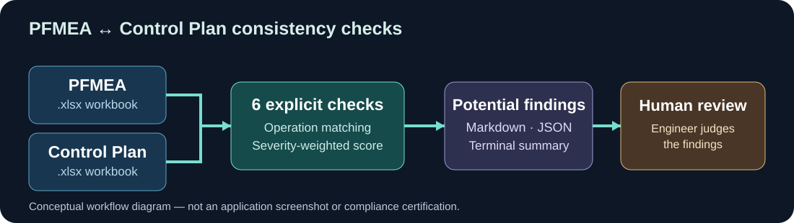
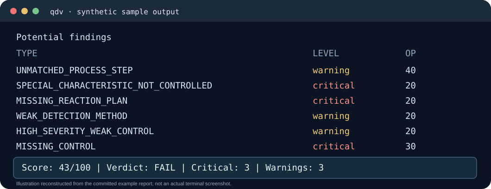

# Quality Docs Validator

### Catch potential inconsistencies between PFMEA and Control Plan — before technical review



A **local-first Python CLI** for quality, process and manufacturing engineers. Compare two `.xlsx` workbooks, surface severity-classified **potential findings**, and produce Markdown or JSON reports without sending your files to a cloud service.

[](https://github.com/migmcc/quality-docs-validator/actions/workflows/ci.yml)
[](LICENSE)
[](https://www.python.org/)

**[Quick start](#quick-start)** · **[See a real example](#see-it-in-action)** · **[What it checks](#what-it-validates)** · **[Limitations](#what-it-does-not-validate-by-design)** · **[Architecture](docs/ARCHITECTURE.md)**

---

## See it in action

Run the **bundled synthetic example** containing deliberately seeded gaps:

```bash
git clone https://github.com/migmcc/quality-docs-validator.git
cd quality-docs-validator
pip install -e .
qdv pfmea-control-plan \
  --pfmea examples/pfmea.xlsx \
  --control-plan examples/control-plan.xlsx \
  --out report.md
```



**Documented sample terminal output (abridged):**

```text
Potential findings
  UNMATCHED_PROCESS_STEP                 warning    Op 40
  SPECIAL_CHARACTERISTIC_NOT_CONTROLLED  critical   Op 20
  MISSING_REACTION_PLAN                  critical   Op 20
  WEAK_DETECTION_METHOD                  warning    Op 20
  HIGH_SEVERITY_WEAK_CONTROL             warning    Op 20
  MISSING_CONTROL                        critical   Op 30

Score: 43/100    Verdict: FAIL
Critical: 3      Warnings: 3
```

[Read the full committed sample report →](examples/report.md)

> **Important:** Findings are *potential inconsistencies* for an engineer to judge. This is **not** a regulatory or standards compliance certification and **does not replace human technical review**.

## The problem

A PFMEA and its Control Plan can look complete when reviewed separately while disagreeing **between** documents: an unmatched process step, a special characteristic not reflected in controls, or no reaction plan where severity is high. Those gaps deserve attention before an audit or submission.

## Who it's for

Quality / Process / Manufacturing Engineers, supplier-quality teams, internal auditors and APQP/PPAP teams working with Excel-based documents.

## What it validates

The current module is a **PFMEA ↔ Control Plan consistency checker**.

| Capability | How it works |
| --- | --- |
| Excel input | Reads PFMEA and Control Plan `.xlsx` workbooks, with a recommended template and common header aliases. |
| Matching | Matches normalised operation IDs and process steps. |
| Six checks | Flags unmatched steps, missing controls, uncontrolled special characteristics, missing reaction plans and two warning-level weak-method heuristics. |
| Scoring | Severity-weighted 0–100 score with PASS / PASS-WITH-WARNINGS / NEEDS-REVIEW / FAIL verdicts. |
| Reports | Rich terminal summary plus Markdown or JSON, suitable for review and automation. |

**[Read the exact finding triggers and scoring rules →](docs/FINDINGS.md)**

## Quick start

**Requirements:** Python 3.12+ and a local checkout of this repository.

```bash
pip install -e .
qdv pfmea-control-plan \
  --pfmea examples/pfmea.xlsx \
  --control-plan examples/control-plan.xlsx \
  --out report.md
```

The bundled examples are synthetic and intentionally contain a gap. To regenerate them, run `python examples/generate_examples.py`.

### JSON output for automation

```bash
qdv pfmea-control-plan \
  --pfmea examples/pfmea.xlsx \
  --control-plan examples/control-plan.xlsx \
  --format json --out report.json
```

The JSON report includes metadata, verdict, score, summary and findings.

### Select sheets in multi-sheet workbooks

```bash
qdv pfmea-control-plan \
  --pfmea pfmea.xlsx --pfmea-sheet "PFMEA" \
  --control-plan control-plan.xlsx --control-plan-sheet "Control Plan" \
  --out report.md
```

If a specified sheet does not exist, the error lists available sheet names.

## What it does not validate (by design)

- Formats other than `.xlsx`; CSV is not currently supported.
- Arbitrary column mapping beyond the recommended template and supported aliases.
- Other document pairs (Process Flow, Work Instructions, PPAP, 8D, SPC, MSA).
- Web interface, ERP / MES / QMS integration, PDF / OCR or AI-based interpretation.
- Regulatory conformity, audit certification or replacements for engineering judgement.

See [scope](docs/MVP_SCOPE.md), [decisions](docs/DECISIONS.md) and [roadmap](docs/ROADMAP.md).

## How it works

`PFMEA.xlsx + Control Plan.xlsx → operation matching → six checks → scoring → terminal / Markdown / JSON`

The rules and scoring are explicitly documented and testable rather than based on an LLM. For implementation details, see [architecture](docs/ARCHITECTURE.md) and [finding reference](docs/FINDINGS.md).

## Get involved

- [Explore the repository](https://github.com/migmcc/quality-docs-validator)
- [Open an issue](https://github.com/migmcc/quality-docs-validator/issues)
- [Contribute](CONTRIBUTING.md)

Licensed under [MIT](LICENSE).
